# ha-vehicle-panel

[](https://www.home-assistant.io/integrations/marketplace/)
[](https://github.com/juju35/ha-vehicle-panel/actions/workflows/hacs.yml)
[](https://github.com/juju35/ha-vehicle-panel/actions/workflows/validate.yml)
[](https://github.com/juju35/ha-vehicle-panel/actions/workflows/lint.yml)
[](https://github.com/juju35/ha-vehicle-panel/releases/latest)
[](https://github.com/juju35/ha-vehicle-panel/blob/main/LICENSE)
[](https://buymeacoffee.com/julienstep9)

<p align="center"></p>


<p align="center">
  &nbsp;
  &nbsp;
  &nbsp;
  &nbsp;
  &nbsp;
  &nbsp;
  &nbsp;
  &nbsp;
  &nbsp;
  &nbsp;
  &nbsp;
  &nbsp;
  &nbsp;
  &nbsp;
  &nbsp;
  &nbsp;
  &nbsp;
  &nbsp;
  &nbsp;
  &nbsp;
  &nbsp;
  &nbsp;
  &nbsp;
  &nbsp;
  &nbsp;
  &nbsp;
  &nbsp;
  &nbsp;
  &nbsp;
  &nbsp;
  &nbsp;
  &nbsp;
  &nbsp;
  
</p>

Home Assistant integration that adds a **Vehicles** panel to the sidebar for your connected cars, **whatever the brand**: range, lock and location of every car at a glance, the week's trips, consumption, the cheapest fuel nearby, maintenance and lease tracking — one tab each.

Pick your cars once: the panel finds their entities by itself, whatever the integration.

<p align="center">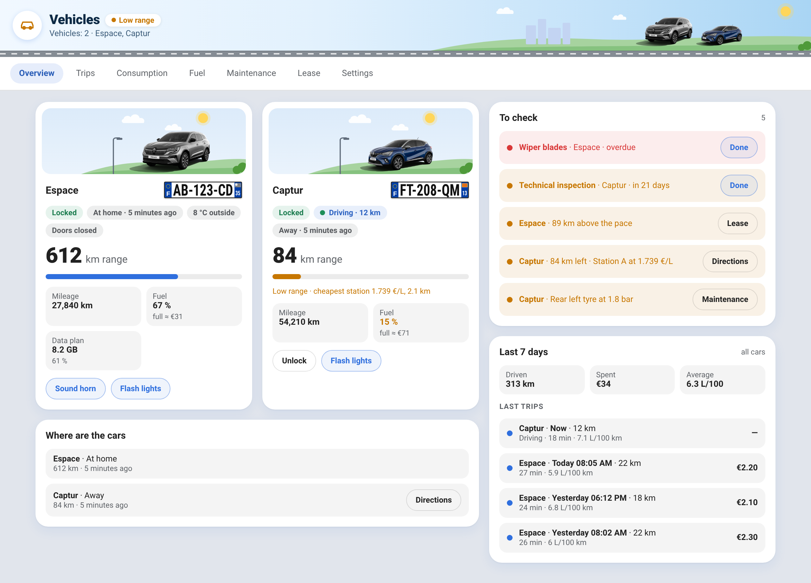</p>

[](https://my.home-assistant.io/redirect/marketplace_repository/?owner=juju35&repository=ha-vehicle-panel&category=integration)

## Features

- A **Vehicles** entry in the sidebar, for every user, with one tab each: Overview, Trips, Consumption, Fuel, Maintenance, Lease and Settings
- An illustrated header with your cars parked by the road (their own photo when the integration gives one), and a status pill: all locked, unlocked, low range, driving
- **Overview**: a tile per car with its picture and its plate drawn like the real one (EU band, department and regional emblem), chips (lock, place and last update, driving, outside temperature, doors, charging), range and gauge with the cost of a full tank, mileage, data plan and its renewal, and every button of the car; where the cars are, on Home Assistant's own map, with directions; one list of what to check, each with its action (Done, Directions, Lock, Log); the last 7 days and the last trips
- **Every action is asked first** in the panel (a button of the car, lock, unlock, Done, a refuel, a service)
- **Trips**: kilometres driven today, this week and day by day over the last 7 days, and each car's recent trips
- **Consumption** (with Vehicle Consumption): the month's consumption against the average, distance, cost and cost per km, CO₂, trips and next service; a 12-month chart of the consumption, distance, cost or CO₂; the recent trips; the refuels (or charges), with **Log a refuel**
- **Fuel** (with Carburants France): the stations of a fuel with their brand, opening hours, distance, 30-day price line, shortages and directions; the best price against the month; the target price; what each car's fill-up costs and the nearest open station; **charging** for an electric or plug-in car and a home charger (battery, end of charge, power, the charger's switches, modes and current)
- **Maintenance**: the vehicle tasks of the Maintenance integration with **Done**, the next service of Vehicle Consumption with **Log**, and each car's tyre pressures around the car seen from above, a low one flagged
- **Lease** (LOA), only the cars with a contract (the tab is hidden without one): the gap to the pace, kilometres left this month and per month to the end, the projection at the recent pace, the excess cost, and the mileage drawn against the contract
- **Settings**: a name, plate and its department, lease contract and price of an extra km, tank, picture and optional devices (consumption, data plan, home charger) per car, the low range alert and whether the location is for administrators only, saved for every user (administrators only)
- Several vehicles, of different brands, side by side
- Automatic entity discovery from the device, for [18 car integrations](#supported-integrations) (whatever the entity IDs or the Home Assistant language)
- English, French, German, Spanish, Serbian (Cyrillic and Latin), Italian, Dutch, European Portuguese, Polish, Romanian, Danish, Swedish, Bulgarian, Russian, Ukrainian, Hungarian, Slovak, Czech, Slovenian, Latvian and Greek, follows the Home Assistant language
- Light and dark theme compatible

## Supported integrations

The panel picks each vehicle's entities by their translation keys (and entity IDs), so it works with these integrations as they are. What each one shows depends on what the car and the integration expose.

| Integration | Brands | Picture |
|---|---|---|
|  [Renault](https://www.home-assistant.io/integrations/renault/) (built in) | Renault, Dacia | With [Renault Picture](https://github.com/juju35/ha-renault-picture) |
|  [Tesla Fleet](https://www.home-assistant.io/integrations/tesla_fleet/),  [Teslemetry](https://www.home-assistant.io/integrations/teslemetry/),  [Tessie](https://www.home-assistant.io/integrations/tessie/) (built in) | Tesla | — |
|  [Volvo](https://www.home-assistant.io/integrations/volvo/) (built in) | Volvo | ✅ (`volvo.get_image_url` action) |
|  [Škoda](https://www.home-assistant.io/integrations/skoda/) (built in),  [MySkoda](https://github.com/skodaconnect/homeassistant-myskoda) | Škoda | — |
|  [Subaru](https://www.home-assistant.io/integrations/subaru/),  [Nissan Leaf](https://www.home-assistant.io/integrations/nissan_leaf/) (built in) | Subaru, Nissan | — |
| 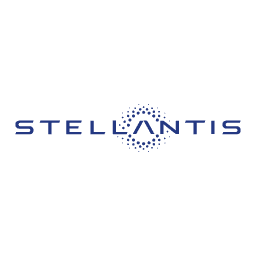 [Stellantis Vehicles](https://github.com/andreadegiovine/homeassistant-stellantis-vehicles) | Peugeot, Citroën, DS, Opel, Vauxhall, Fiat, Jeep, Alfa Romeo… | ✅ |
|  [Kia / Hyundai (kia_uvo)](https://github.com/Hyundai-Kia-Connect/kia_uvo) | Kia, Hyundai, Genesis | — |
|  [Mercedes-Benz (mbapi2020)](https://github.com/ReneNulschDE/mbapi2020) | Mercedes-Benz, smart | — |
|  [Toyota](https://github.com/pytoyoda/ha_toyota) | Toyota, Lexus | ✅ |
| [VW Group Connect (vag_connect)](https://github.com/its-me-prash/vwgroup-connect-ha),  [Volkswagen We Connect](https://github.com/robinostlund/homeassistant-volkswagencarnet) | Volkswagen, Audi, Seat, Cupra, Škoda | ✅ (renders) |
|  [Uconnect](https://github.com/hass-uconnect/hass-uconnect) | Fiat, Jeep, Alfa Romeo, Ram, Chrysler, Dodge | ✅ |
|  [Polestar](https://github.com/leeyuentuen/polestar_api),  [FordPass](https://github.com/itchannel/fordpass-ha) | Polestar, Ford | — |
| Any other integration | Any car with a `device_tracker` and sensors | Your own `image` entity (Settings tab) |

Optional integrations:

| Integration | What the panel shows |
|---|---|
|  [Renault Picture](https://github.com/juju35/ha-renault-picture) (Marketplace) | The official MyRenault photo of the vehicle, in the header and on its tile |
| [Vehicle Consumption](https://github.com/juju35/ha-vehicle-consumption) (Marketplace) | The month's figures, the 12-month chart, the trips, the refuels and charges (and logging one), the next service (and logging it), the lease status, whether the car is driving |
| [Carburants France](https://github.com/juju35/ha-carburants-france) (Marketplace) | The stations of each fuel (found by themselves), opening hours, shortages, 30-day prices, the target price, directions |
| [Maintenance](https://github.com/juju35/ha-maintenance) (Marketplace) | The tasks of the vehicle category (found by themselves), overdue and due soon first, marked done from the panel |
|  [Orange Internet On the move](https://github.com/juju35/ha-orange-internet-on-the-move) (Marketplace) | Data left on the car's data plan |

## Prerequisites

Home Assistant 2026.11 or later with one of the [supported car integrations](#supported-integrations) set up. The other integrations above are optional: each adds its tab's content when it is there.

## Installation

### Via the Marketplace (recommended)

Click the button below to add the repository directly:

[](https://my.home-assistant.io/redirect/marketplace_repository/?owner=juju35&repository=ha-vehicle-panel&category=integration)

Then click **Install** and restart Home Assistant.

Or manually:

1. Open **Settings → Marketplace → Add from link** (top right; this needs a GitHub account connected)
2. Add `https://github.com/juju35/ha-vehicle-panel` — Type: **Integration**
3. Open **Vehicle Panel** and click **Install**, then restart Home Assistant

Then **Settings → Devices & services → Add integration → Vehicle Panel**: pick your vehicles (and, if you have them, your fuel stations and maintenance entities) and the **Vehicles** entry appears in the sidebar. The panel is served by the integration itself: there is no dashboard resource to add (nothing under `/local/community/`).

### Manual

1. Download `vehicle_panel.zip` from the [latest release](https://github.com/juju35/ha-vehicle-panel/releases/latest)
2. Extract it to `/config/custom_components/vehicle_panel/`
3. Restart Home Assistant and add the **Vehicle Panel** integration

## Panel

The **Vehicles** entry of the sidebar, at `/vehicles` (each tab has its own address: `/vehicles/trips`, `/vehicles/consumption`, `/vehicles/fuel`, `/vehicles/maintenance`, `/vehicles/lease`, `/vehicles/settings`). Every user sees it; only administrators can change its settings.

At its top, a 90 px illustrated bar: your cars parked by the road, the car icon in the colour of the status, the title with its status pill (all locked in green; unlocked or low range in amber) and the names of your cars. The night picture follows Home Assistant's dark theme.

| Light | Dark |
|---|---|
|  | 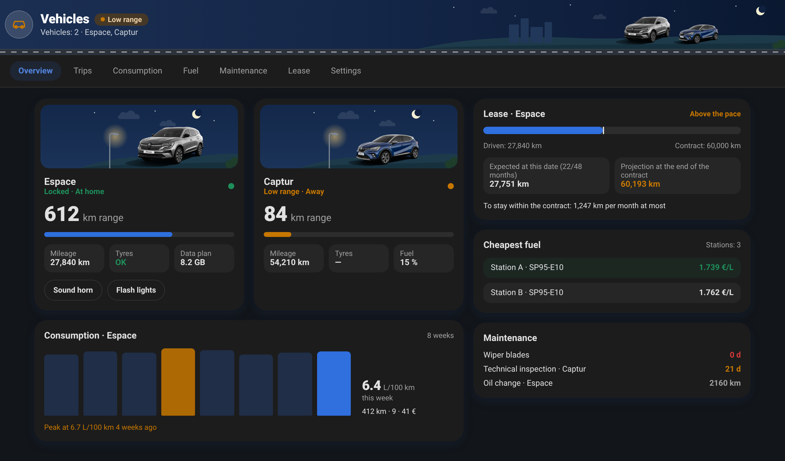 |
| 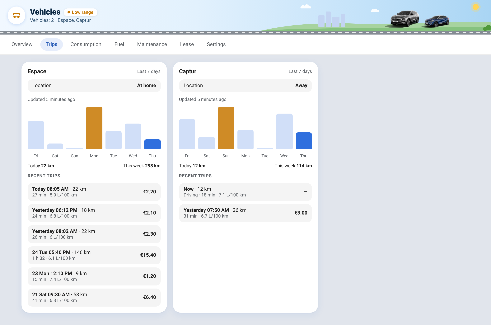 | 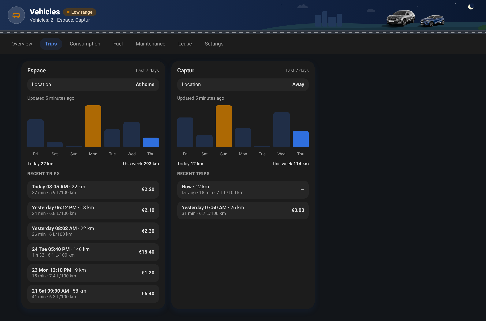 |
| 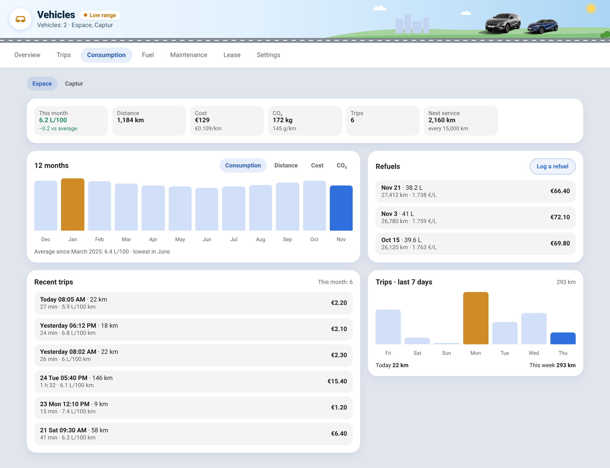 | 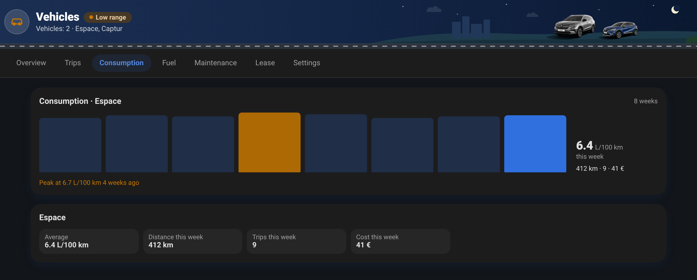 |
| 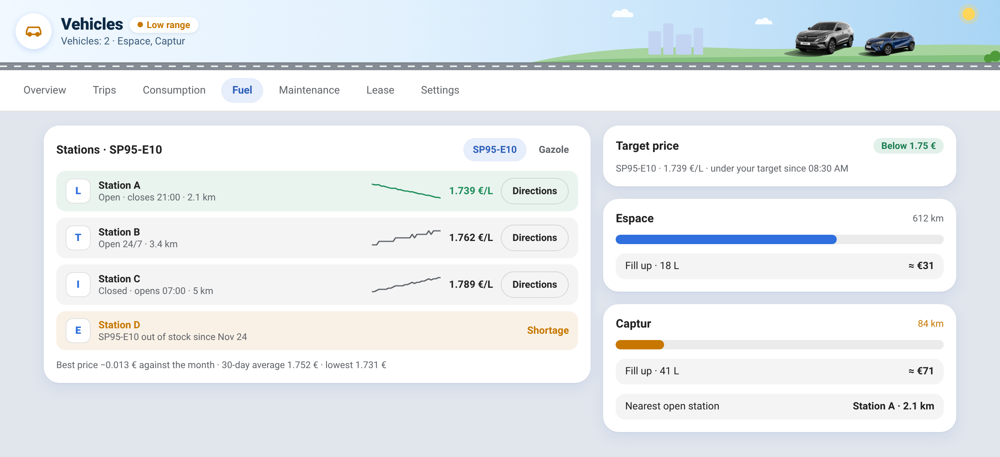 | 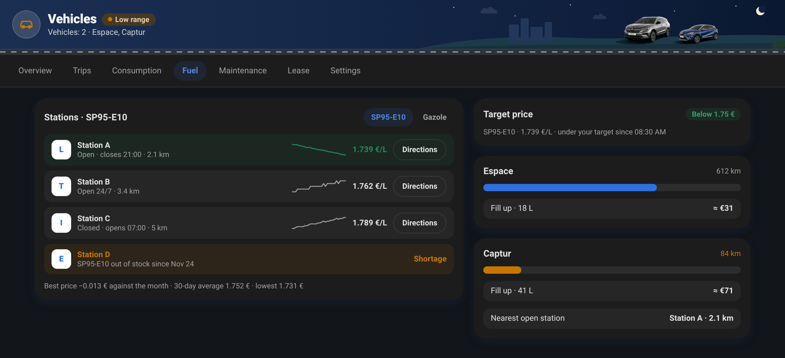 |
| 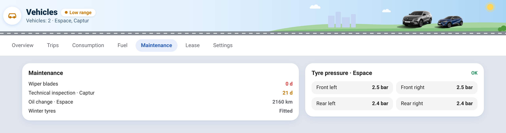 | 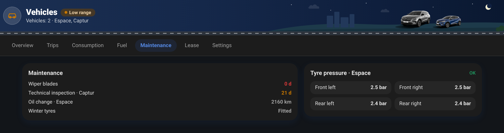 |
| 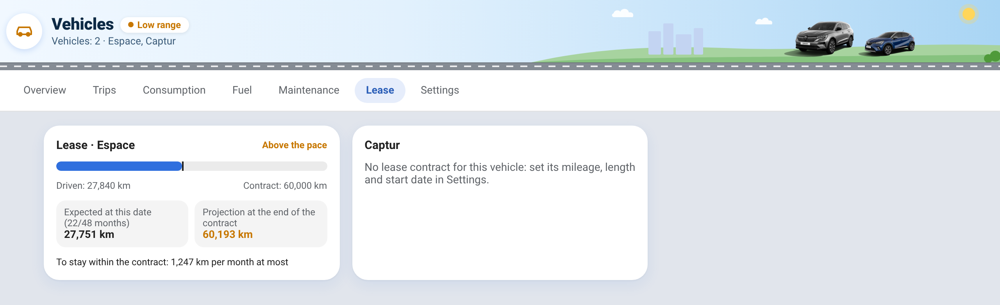 | 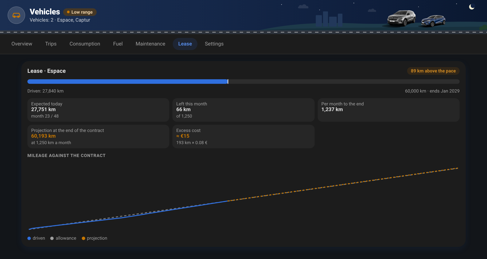 |
| 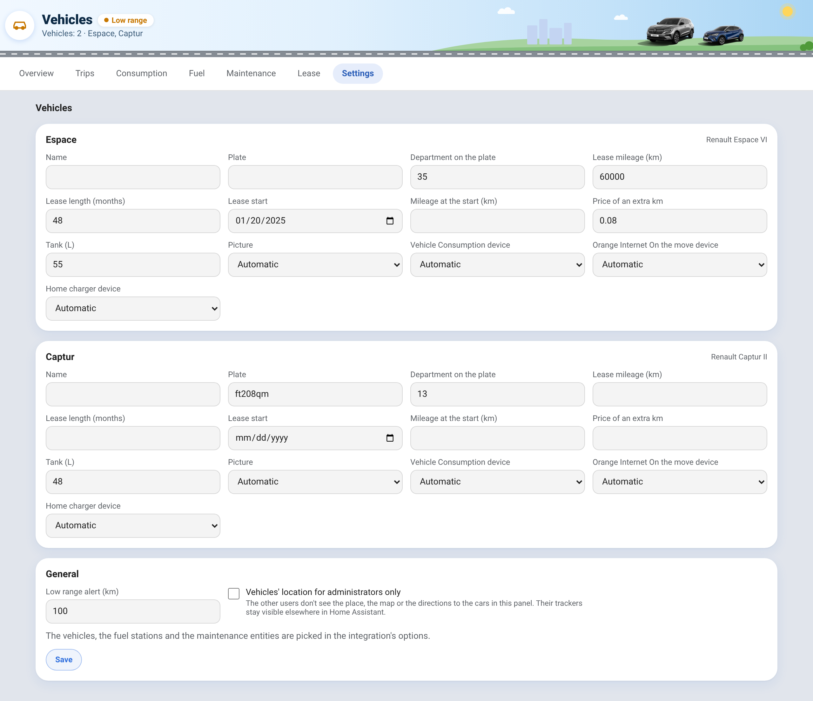 | 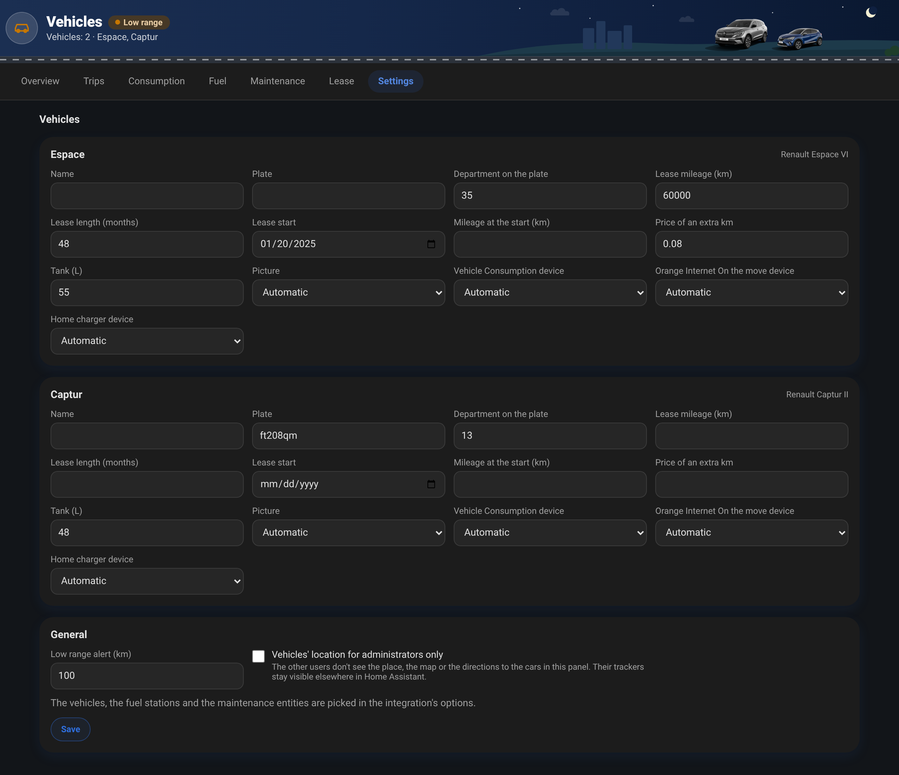 |

### Settings

The vehicles, the fuel stations, the maintenance entities and the low range alert are picked in the integration's options (**Settings → Devices & services → Vehicle Panel → Configure**). Each car's own settings are set in the panel's **Settings** tab:

| Setting | What it does |
|---|---|
| Name | The name shown in the panel (default: the device's name) |
| Plate | The plate drawn on the car's tile like the real one (EU band, department); default: the device's name when it is a French registration (`GW782EN` → `GW-782-EN`). Any other registration is shown as typed |
| Department on the plate | The department on the right band, e.g. `35`; those of Brittany, Occitania, Île-de-France, Provence, Corsica and Burgundy get their traditional regional emblem |
| Contract mileage, duration, start and mileage at the start | The lease contract the Lease tab follows (Vehicle Consumption's lease, when it has one, comes first) |
| Price of an extra km | The excess cost of the projected kilometres over the contract |
| Tank | The tank capacity in litres: the fuel level from the fuel quantity, and the cost of a full tank |
| Picture | The `image` or `sensor` entity whose picture is shown (default: found from the device, e.g. Renault Picture) |
| Vehicle Consumption device, Orange Internet On the move device | The devices of the optional integrations (default: the one whose name matches the car) |
| Home charger device | The charger whose controls the Fuel tab shows with the car |
| Low range alert | Below this range (km), the status turns amber (default 100 km) |
| Vehicles' location for administrators only | The other users don't see the place, the map or the directions to the cars in the panel (off by default). Their `device_tracker` entities stay readable elsewhere in Home Assistant: this is not a permission |

## How it works

The integration registers the panel and keeps its settings in its config entry. The panel reads the device and entity registries the frontend already has, lists the entities of each chosen device and matches each one by its translation key, then by its entity ID (English and French slugs), then by its device class, so renamed entities and entity IDs in another language are supported. Everything the device exposes as a `button` becomes an action button (`button.press`).

The devices of Vehicle Consumption and Orange Internet On the move are linked to the car whose name or model they carry, and the Renault Picture entity to its device; each can be set by hand in the Settings tab. The 7-day bars and the station price lines come from the recorder's history (8 days of mileage, 8 weeks of average consumption, 30 days of the prices of the fuel shown), and the lease chart and this month's kilometres from the monthly statistics of the mileage, fetched again every 10 minutes at most. The Stations sensors of Carburants France and the sensor of Maintenance that carries its items are found by themselves; the fuel and maintenance entities picked in the options are still shown when those are missing. Directions open Google Maps.

## Development

```bash
pip install -r requirements_test.txt && pytest   # integration tests (Home Assistant test harness)
npm ci && npm test                               # assembles the panel (npm run build), then its tests
npm run screenshots                              # renders the panel with mock data into screenshots/ (needs ffmpeg)
```

The panel (`vehicle-panel.js`) is a plain JavaScript module served by the integration from `custom_components/vehicle_panel/frontend/`, with its language files (`frontend/i18n/`). Its source is split into ES modules under `src/vehicle-panel/` (entry `index.js`); `npm run build` (`scripts/build-frontend.mjs`) assembles them into the file in `frontend/`, which is not committed (the release builds it into the zip). The modules share one scope, so top-level names stay unique across them, and a new module must be listed in `index.js`.

The car pictures in `scripts/pictures/` are used for the screenshots only.

### Releasing

1. Bump the version in `custom_components/vehicle_panel/manifest.json`, `const.py` (`VERSION`), `src/vehicle-panel/core.js` (`VEHICLE_PANEL_VERSION`) and `package.json` (`npm install` updates `package-lock.json`)
2. Add a `## <version>` section at the top of [CHANGELOG.md](https://github.com/juju35/ha-vehicle-panel/blob/main/CHANGELOG.md)
3. Push to `main`: the **Release** workflow checks that the versions agree, creates the tag and the GitHub release with the changelog section as notes, and attaches `vehicle_panel.zip`

## Translations

The panel follows the language of your Home Assistant profile; the sidebar title follows the server's language. Currently supported:

| Language | Code |
|---|---|
| English | `en` |
| Français | `fr` |
| Deutsch | `de` |
| Español | `es` |
| Српски | `sr` |
| Srpski (latinica) | `sr-Latn` |
| Italiano | `it` |
| Nederlands | `nl` |
| Português (Portugal) | `pt` |
| Polski | `pl` |
| Română | `ro` |
| Dansk | `da` |
| Svenska | `sv` |
| Български | `bg` |
| Русский | `ru` |
| Українська | `uk` |
| Magyar | `hu` |
| Slovenčina | `sk` |
| Čeština | `cs` |
| Slovenščina | `sl` |
| Latviešu | `lv` |
| Ελληνικά | `el` |

Other variants fall back to the base language: `pt-BR` uses European Portuguese, `nl-BE` Dutch.

Contributions for additional languages are welcome!

## License

[MIT](https://github.com/juju35/ha-vehicle-panel/blob/main/LICENSE)

## Support

If you find this project useful, you can support its development:

<a href="https://buymeacoffee.com/julienstep9"></a>
